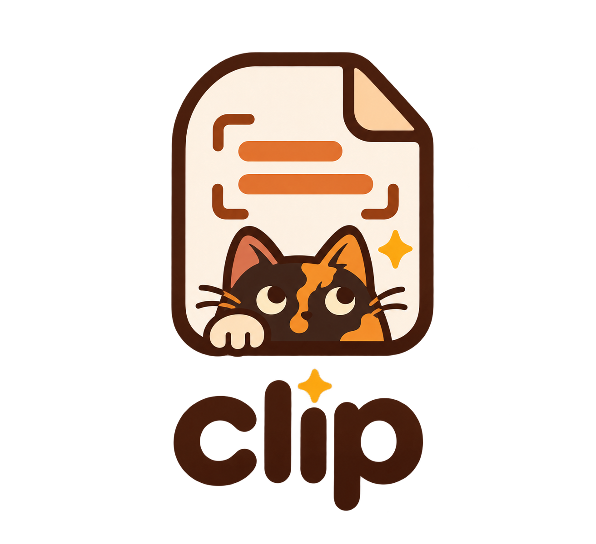

<p align="center"></p>

# Clip

Tiny clipboard history + screen text grabber (OCR) for macOS. A `clip` CLI and a menu bar app.

## Install

Needs macOS 13+ and Apple's command line tools (`xcode-select --install` if you don't have them).

```sh
git clone https://github.com/nzdable/clip.git
cd clip
./build.sh
open ~/Applications/Clip.app
```

This installs:
- `~/.local/bin/clip`, the CLI
- `~/Applications/Clip.app`, the menu bar app
- A background job that runs `clip watch` at login, so every copy is saved

Then:
1. If `clip` says "command not found", add this to `~/.zshrc`: `export PATH="$HOME/.local/bin:$PATH"`
2. The first time you press ⌘⇧2, macOS asks for **Screen Recording** permission. Allow it in System Settings → Privacy & Security.
3. Optional: turn on **Open at Login** in the menu bar app.

To update, run `git pull && ./build.sh`. Running it again is safe.

## Uninstall

```sh
launchctl bootout gui/$(id -u)/com.nzdable.clip
rm -rf ~/.local/bin/clip ~/Applications/Clip.app ~/Library/LaunchAgents/com.nzdable.clip.plist ~/.clip_history.json
```

## Use

| Command | What it does |
|---|---|
| `clip watch` | Run in background, save every text you copy |
| `clip` | List recent items |
| `clip <word>` | List items containing `<word>` |
| `clip <N>` | Copy item N back to the clipboard |
| `clip clear` | Wipe history |
| `clip scrub` | Remove saved items that look like keys or passwords |
| `clip ocr [img]` | Grab text from a screen area (or image file) |

Menu bar app:
- **⌘⇧1** opens the history window. Each clip shows when you copied it. Type to search, click or press Enter to copy, Esc to close. **Clear all** (tap twice) wipes the history.
- **⌘⇧2** grabs text from the screen.

## Privacy

- History is stored only on your Mac in `~/.clip_history.json` (owner-only, `0600`). Nothing is sent anywhere.
- Items marked secret by password managers (`ConcealedType` / `TransientType`) are never saved.
- Text that looks like a key is never saved either: AWS, GitHub, Slack, Stripe, Google, Anthropic/OpenAI keys, private keys, JWTs, `user:password@` URLs, and `.env` lines like `PASSWORD=...`. It stays on your clipboard, so pasting still works.
- `clip scrub` removes anything key-like that was saved before.
- OCR screenshots are deleted right after the text is read.
- Last 200 items are kept. Run `clip clear` to wipe them.

## License

[MIT](LICENSE)
